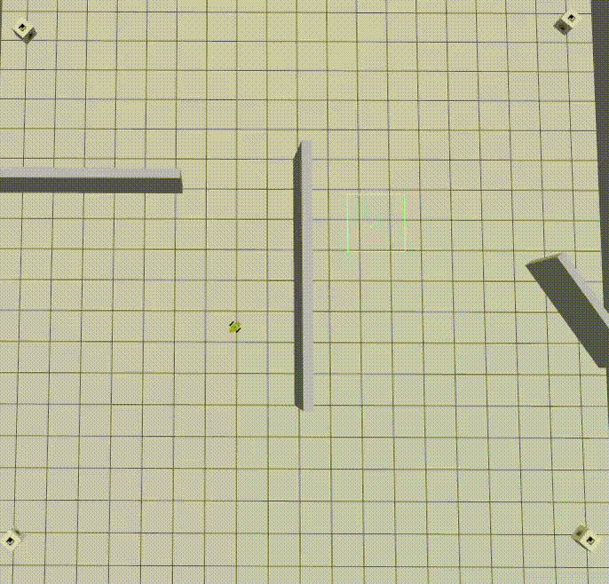
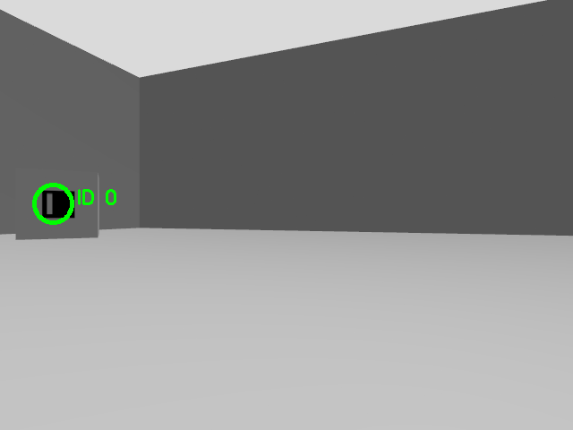
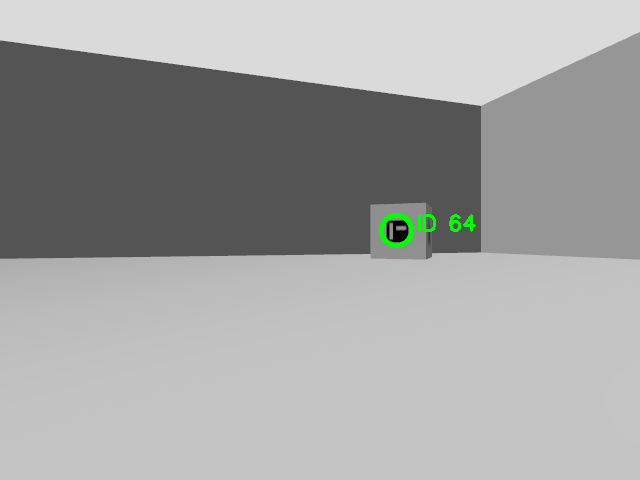
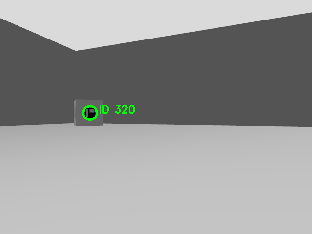
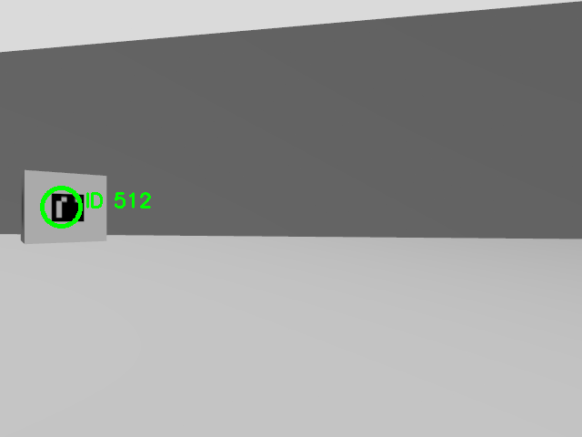
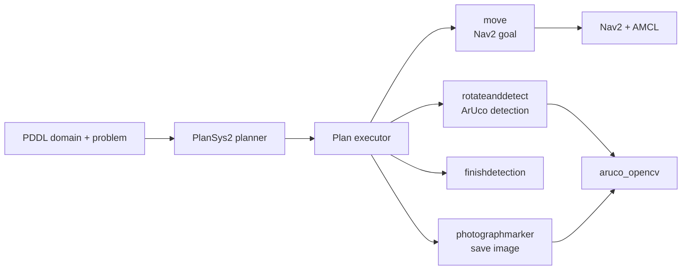

<div align="center">

# 🤖 Autonomous Marker Mission with ROS 2 & PlanSys2

**A mobile robot that finds ArUco markers, remembers where they are, and photographs them in order of increasing ID, all driven by a symbolic PDDL planner.**




<sub>Robot executing the mission in Gazebo (sped up).</sub>

[Demo video](resources/exp2.mp4) · [Quick start](#-quick-start) · [How it works](#-how-it-works) · [Repository layout](#-repository-layout)

</div>

---

## ✨ What it does

1. **Discover**: the robot drives to a series of hint waypoints and spins in place until it sees an ArUco marker, then records the marker's ID and pose.
2. **Photograph**: once all markers are known, it revisits them **from the lowest ID to the highest** and takes a picture of each one.

Everything runs in simulation (Gazebo world). The design is modular, so the same action nodes can be moved to a real robot.

> Course project for *Experimental Robotics Laboratory*, University of Genoa.

## 🎬 Demo

| Mission run | Marker snapshots |
|---|---|
| [▶ Watch the full video](resources/exp2.mp4) |     |

The snapshot filenames (`0`, `64`, `320`, `512`) are the IDs of the markers the robot found.

## 🧠 How it works

High-level decisions come from **PlanSys2**. A PDDL planner produces a sequence of symbolic actions, and each action is backed by a ROS 2 node that does the real work (Nav2 navigation, camera detection, image capture).



**Mission phases**

| Phase | Repeats | Steps |
|---|---|---|
| Discovery | 4× | go to next hint waypoint → rotate until a marker is detected → record its ID and pose |
| Photographing | 4× | go to the pose of the lowest remaining ID → rotate until the marker is seen → take a picture |

**PDDL actions** (`ws/src/plansys_interface/domain/domain.pddl`)

| Action | Purpose |
|---|---|
| `move` | Navigate between connected waypoints |
| `rotateanddetect` | Rotate in place and detect the marker visible at this waypoint |
| `finishdetection` | Fires once all 4 markers are detected and unlocks the photographing phase |
| `photographmarker` | Photograph a detected marker (only after detection is complete) |

## 🚀 Quick start

**Prerequisites:** Ubuntu with ROS 2 **Jazzy** and Gazebo.

1. **Place the marker model.** Make sure the `aruco_box` model folder is in `/home/ubuntu/gazebo_models/`.

2. **Install dependencies**

```bash
sudo apt update
sudo apt install ros-jazzy-nav2-bringup ros-jazzy-slam-toolbox ros-jazzy-plansys2-*
sudo apt install 'ros-jazzy-nav2*'
```

3. **Build** (from the `ws` folder)

```bash
cd ws
colcon build
source install/setup.bash
```

## ▶️ Running the mission

Run each command in its **own terminal** (source `ws/install/setup.bash` in each one).

**1. PlanSys2 planner and action nodes**

```bash
ros2 launch plansys_interface distributed_actions_assignment.launch.py
```

**2. Gazebo simulation**

```bash
ros2 launch bme_gazebo_sensors spawn_robot.launch.py world:=simple_world.sdf rviz_config:=gps.rviz x:=0 y:=1.0 z:=0.1
```

**3. Localization** (uses the pre-built map)

```bash
ros2 launch ros2_navigation assignment_localization.launch.py
```

**4. Navigation server**

```bash
ros2 launch ros2_navigation navigation.launch.py
```

**5. Start the mission**

```bash
ros2 run plansys_interface get_plan_and_execute
```

<details>
<summary><b>🗺️ Re-generating the map (optional)</b></summary>

A map is already included in `ws/src/ros2_navigation/maps`. To build a new one, start the simulation, then:

```bash
ros2 launch ros2_navigation mapping.launch.py
```

Drive the robot around with the keyboard:

```bash
ros2 run teleop_twist_keyboard teleop_twist_keyboard --ros-args -r cmd_vel_teleop:=cmd_vel
```

Watch the map grow in RViz. When it looks complete, save it from inside `ws/src/ros2_navigation/maps`:

```bash
ros2 run nav2_map_server map_saver_cli -f my_new_map
```

</details>

## 📁 Repository layout

```text
ws/src/
├── plansys_interface/   # ⭐ Main work: PDDL domain/problems, PlanSys2 action nodes, launch files
├── ros2_navigation/     # Nav2, AMCL and SLAM Toolbox configs, maps, launch files
├── erl1_sensors/        # Robot model (URDF), sensors and Gazebo worlds
├── erl1/                # Base robot description and worlds
├── ros_aruco_opencv/    # ArUco marker detection (third-party)
└── plansys2_interface/  # Custom messages and services (marker pose)
resources/               # Demo video, GIF and marker screenshots
```

## 🛠️ Built with

[ROS 2 Jazzy](https://docs.ros.org/en/jazzy/) · [PlanSys2](https://plansys2.github.io/) · [Nav2](https://docs.nav2.org/) · [SLAM Toolbox](https://github.com/SteveMacenski/slam_toolbox) · [ros_aruco_opencv](https://github.com/fictionlab/ros_aruco_opencv) · Gazebo

## 👥 Authors

| Name | Student ID |
|---|---|
| Ahmed Yousef | 6848239 |
| Maze Atta | 7146206 |
| Mohamed Ismail | 6655420 |

*Experimental Robotics Laboratory, University of Genoa.*
